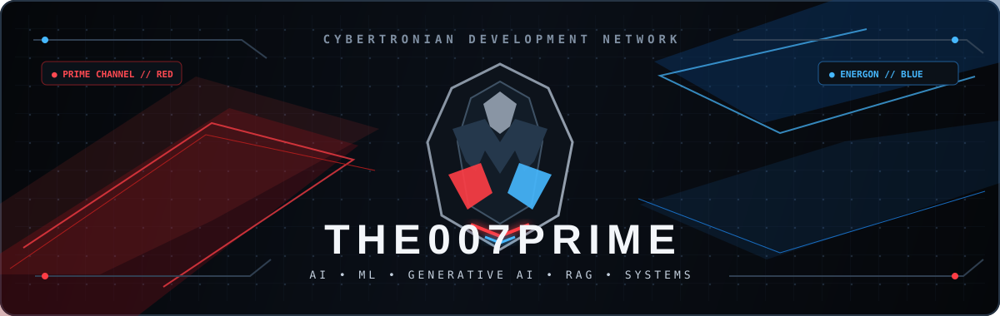
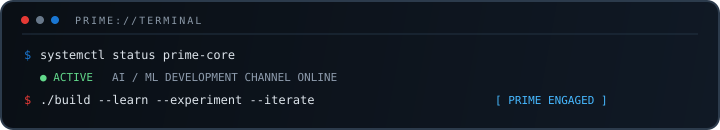

<div align="center">



<br/>


<br/>

# `THE007`

### AI / ML ENGINEER IN PROGRESS

**Machine Learning • Generative AI • LLMs • RAG • AI Agents • Linux**

Building practical AI systems with a focus on fundamentals, reliability, experimentation, and understanding how things work.

<br/>

<a href="https://github.com/the007prime">
  
</a>
<a href="https://github.com/the007prime?tab=repositories">
  
</a>

<br/><br/>

<a href="https://www.linkedin.com/in/akshay-s-9b2615447">
  
</a>
<a href="https://reddit.com/user/007PRIMEYYY">
  
</a>
<a href="https://instagram.com/_dayumprime">
  
</a>
<a href="mailto:the007prime@gmail.com">
  
</a>

</div>

---

## About Me

I'm a self-taught developer and aspiring **AI / ML Engineer**, interested in understanding, developing, and improving intelligent systems.

My work and learning revolve around machine learning, deep learning, generative AI, and building practical AI applications.

### Current Interests

- Machine Learning and model evaluation
- Deep Learning and neural networks
- Transformers, LLMs, and embeddings
- Retrieval-Augmented Generation (RAG)
- LLM fine-tuning with PEFT, LoRA, and QLoRA
- AI agents and agentic workflows
- Local, self-hosted, and offline AI systems
- Linux, containers, and developer tooling

I value **understanding over abstraction**. I prefer learning the underlying mathematics and engineering principles before relying on high-level abstractions.

---

## Featured Projects

| Project | Description |
|---|---|
| [CORE](https://github.com/the007prime/CORE) | An offline-first RAG system focused on private, local document retrieval and question answering. |
| [Qwen-PRIME-4B](https://huggingface.co/primeyyy/Qwen-PRIME-4B-AI) | Fine-tuned Qwen3-4B using parameter-efficient fine-tuning techniques and a custom instruction dataset. |
| [Churn-Pulse](https://churnpulse-ann-primeyyy.streamlit.app/) | An ML-based customer churn analysis application incorporating SHAP for model explainability. |

---

## Tech Stack

<div align="center">

### Languages & Development


<br/><br/>

### Machine Learning & AI


<br/><br/>

`Transformers` `PEFT` `LoRA` `QLoRA` `RAG` `Ollama` `NumPy` `Pandas` `Matplotlib` `SciPy`

<br/><br/>

### Infrastructure & Developer Tools


<br/><br/>

`Podman` `Postman` `CMake` `NPM` `MLflow`

</div>

---

## Current Learning Path

```text
Machine Learning
       |
       v
Deep Learning
       |
       v
Transformers & LLMs
       |
       v
RAG & Information Retrieval
       |
       v
LLM Fine-tuning
       |
       v
AI Agents & Agentic Systems
       |
       v
Production-grade AI Engineering
```

**Current focus:** Building reliable agentic systems, understanding agent architectures, tool use, orchestration, and integrating LLMs with practical applications.

---

## Engineering Approach

> **Understand the system. Build it. Measure it. Improve it.**

My engineering principles:

- Understand the fundamentals before using abstractions.
- Prefer working implementations over unnecessary complexity.
- Evaluate systems instead of relying on assumptions.
- Build with reliability, maintainability, and privacy in mind.
- Keep experimenting, learning, and improving.

---

## GitHub Statistics

<div align="center">


<br/><br/>


<br/><br/>


</div>

---

## Contributions

<div align="center">


<br/><br/>


</div>

---

<div align="center">



<br/><br/>

**LEARNING • BUILDING • EXPERIMENTING • ITERATING**

</div>
